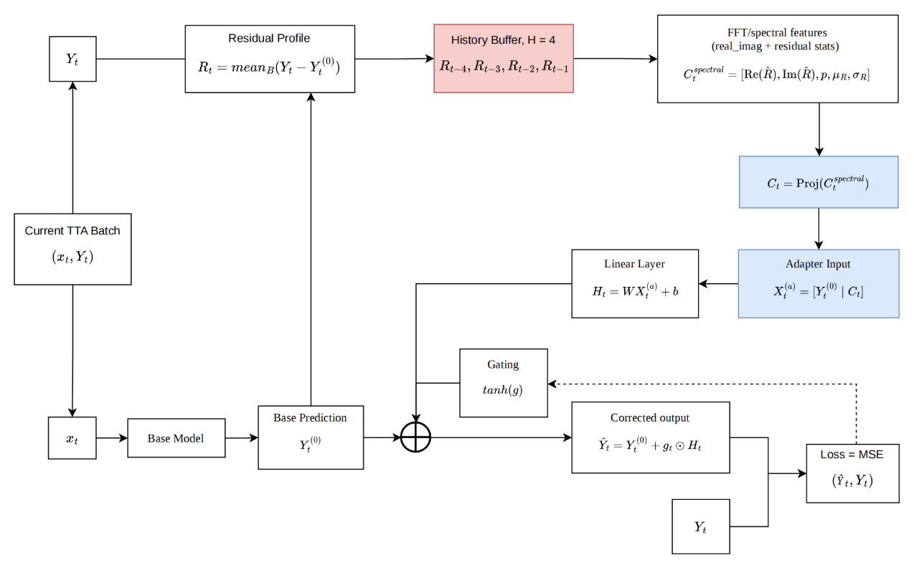

# Residual-Frequency Test-Time Adaptation for Time-Series Forecasting

Pretrained forecasters degrade when the data distribution drifts after deployment. Test-time adaptation (TTA) corrects them online without retraining. This project builds on [COSA](https://openreview.net/forum?id=L7Z5wBMPrW) (ICLR 2026), which corrects a frozen model's output with a gated linear adapter. We ask a simple question: **does the frequency content of the model's recent errors tell the adapter how to correct it?**

We propose **DSA (Direct Spectral Adapter)**, a lightweight output-space adapter conditioned on FFT features of recent prediction residuals. The backbone stays frozen and only the small adapter is updated at test time.



## Method

1. The frozen backbone predicts $Y_t^{(0)} = f_\theta(x_t)$.
2. After each adaptation batch, the residual profile $R_t = \mathrm{mean}_B(Y_t - Y_t^{(0)})$ is pushed into a history buffer of size $H=4$.
3. The buffered profiles are averaged and centered, then transformed with rFFT. The first $K=8$ non-DC bins (real and imaginary parts) are kept, together with the residual power ratio, mean, and scale: $C_t^{spec} = [\mathrm{Re}(\hat R), \mathrm{Im}(\hat R), p, \mu_R, \sigma_R]$.
4. The context is projected, $C_t = \mathrm{Proj}(C_t^{spec}) \in \mathbb{R}^8$, and concatenated with the base prediction.
5. A linear adapter outputs a gated correction, $\hat Y_t = Y_t^{(0)} + \tanh(g) \odot (W[Y_t^{(0)} \mid C_t] + b)$, trained online with MSE.

Implementation: [`Spectral-master/tta/direct_spectral.py`](Spectral-master/tta/direct_spectral.py), with the shared adapter base in [`direct_adapter_base.py`](Spectral-master/tta/direct_adapter_base.py).

## Results

The evaluation grid has 192 configurations: 8 datasets × 6 backbones (DLinear, FreTS, iTransformer, MICN, OLS, PatchTST) × 4 horizons (96, 192, 336, 720). Of these, 171 completed; the rest failed during backbone training, mostly from GPU out-of-memory on Electricity and Traffic. Every result is averaged over 3 seeds, with look-back 96 and a 0.7/0.1/0.2 split.

Test MSE averaged over backbones and horizons:

| Dataset | No TTA | COSA | Spectral context | Balanced PEFT | RESPECT | **DSA** |
|---|---:|---:|---:|---:|---:|---:|
| ETTh1 | 0.588 | 0.549 | 0.525 | 0.541 | **0.505** | 0.513 |
| ETTh2 | 0.253 | 0.241 | 0.241 | 0.238 | 0.236 | **0.230** |
| ETTm1 | 0.488 | 0.462 | 0.427 | 0.455 | **0.420** | 0.442 |
| ETTm2 | 0.179 | 0.179 | 0.161 | 0.171 | 0.157 | **0.152** |
| Exchange | 0.392 | 0.216 | 0.214 | 0.268 | 0.204 | **0.197** |
| Weather | 0.265 | 0.264 | 0.215 | 0.238 | 0.206 | **0.199** |
| Electricity | 0.205 | 0.197 | 0.191 | 0.193 | **0.184** | 0.191 |
| Traffic | 0.590 | 0.572 | 0.570 | 0.570 | **0.549** | 0.570 |
| **Average** | 0.3543 | 0.3169 | 0.2982 | 0.3163 | 0.2889 | 0.2911 |

- DSA lowers average MSE from **0.3543 to 0.2911** relative to the frozen backbone, and beats COSA in 141 of 171 configurations.
- DSA has the lowest MSE in **72 of 171** configurations among all seven methods compared; the seventh is COSA with PAAS batching, which is not shown in the table.
- RESPECT, a heavier complex-modulation design, is slightly more accurate on average (0.2889). DSA has **higher throughput in all 171 configurations** (median 1.3×) and is more accurate on ETTh2, ETTm2, Exchange, and Weather. For some datasets and horizons, the simpler adapter therefore gives the better accuracy–efficiency trade-off.

Raw and averaged results: [`result/2026-06-06_direct_spectral_adapter_ablation_diagnosis/`](result/2026-06-06_direct_spectral_adapter_ablation_diagnosis/) (DSA, including ablations) and [`result/5.26_paper8_experiment/`](result/5.26_paper8_experiment/) (baselines and spectral context).

## Branches

Each design explored in this project lives on its own branch:

| Branch | Method |
|---|---|
| `main` | **DSA**: direct residual-spectrum context adapter (this page) |
| `Spectral` | Spectral context added to COSA's mean-history context, plus the full 8-dataset benchmark pipeline |
| `c/2026-05-29-balanced-spectral-peft` | Multi-window spectral conditioning with a PEFT-style backend mixture |
| `2026-05-29-respect-tta` | RESPECT: adapter context plus complex spectral modulation |

## Running

```bash
cd Spectral-master && pip install -r requirements.txt && cd ..

# Unit tests for the adapter
python Spectral-master/tests/test_direct_spectral_adapter.py

# DSA on the hard subset (ETTm1 / Weather, horizons 336 and 720)
TARGET_SCOPE=hard_subset STAGES=direct_spectral \
  bash script/2026-06-06_direct_spectral_adapter/run_direct_spectral_hard_subset.sh
```

The runner reuses pretrained backbone checkpoints. To train them, use the `train` stage of `script/5.26/run_paper8_spectral.sh` on the `Spectral` branch. Add `DRY_RUN=True` to print the commands without running them. Datasets go in `Spectral-master/datasets/`.

## Acknowledgements and license

Built on the official COSA implementation:

> COSA: Context-aware Output-Space Adapter for Test-Time Adaptation in Time Series Forecasting. ICLR 2026. [OpenReview](https://openreview.net/forum?id=L7Z5wBMPrW)

The COSA code is released under [CC BY-NC-SA 4.0](Spectral-master/LICENSE), and this derivative work is shared under the same license.
