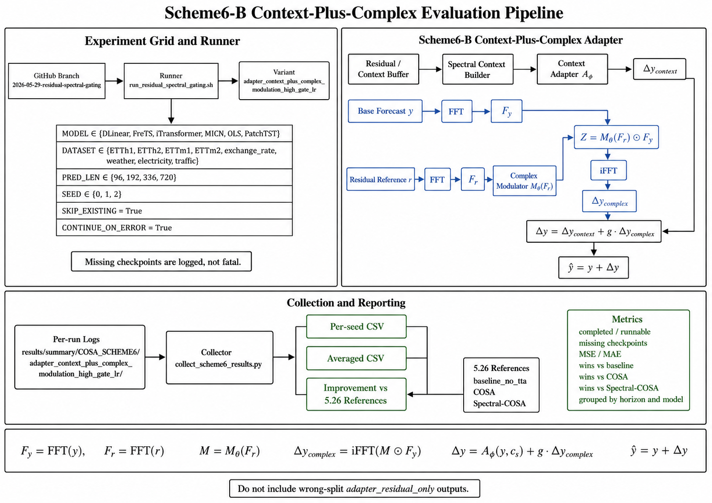

# COSA to Spectral Experiment Project

## Method Overview: Scheme6-B

The current branch focuses on Scheme6-B: residual-conditioned complex frequency
modulation for online test-time adaptation. It keeps COSA's online residual
buffer and frozen base model, but replaces the time-domain output adapter with a
frequency-native correction operator.



Scheme6-B uses the historical residual spectrum to generate a complex modulator
for the current prediction spectrum:

| Formula | Meaning |
|---|---|
| $Y_t^{(0)} = f_{\theta}(X_t)$ | Frozen base prediction from the pretrained backbone. |
| $R_t = Y_t - Y_t^{(0)}$ | Residual profile / base prediction error. |
| $F_y = \mathrm{FFT}(Y_t^{(0)})$ | Frequency representation of the current prediction. |
| $F_r = \mathrm{FFT}(R_{buf})$ | Frequency representation of recent residual reference. |
| $M = M_{\theta}(F_r)$ | Residual-conditioned complex modulation operator. |
| $\Delta Y_t = \mathrm{iFFT}(M \odot F_y)$ | Frequency-native correction returned to time domain. |
| $\hat{Y}_t = Y_t^{(0)} + g_t \odot \Delta Y_t$ | Corrected output with global gate. |
| $\mathcal{L}_{adapt} = \mathrm{MSE}(\hat{Y}_t, Y_t)$ | Adaptation loss for updating only Scheme6-B adapter parameters. |

Compared with COSA-Spectral, which feeds residual FFT features into a
time-domain adapter, Scheme6-B directly applies a residual-conditioned complex
operator to the forecast spectrum. For evaluation, both MSE and MAE are
reported. The base model remains frozen; only adapter-related parameters are
updated during test-time adaptation.

## 2026-05-27 Experiment Design

This repository keeps the original COSA/Spectral implementation under
`Spectral-master/` and the course experiment orchestration scripts under
`script/5.26/`.

The current main experiment is driven by:

```bash
bash script/5.26/run_paper8_spectral.sh
```

This script runs the paper-style grid plus two additional datasets:

- Datasets: `ETTh1`, `ETTh2`, `ETTm1`, `ETTm2`, `exchange_rate`, `weather`,
  `electricity`, and `traffic`
- Models: `DLinear`, `FreTS`, `iTransformer`, `MICN`, `OLS`, and `PatchTST`
- Prediction horizons: `96`, `192`, `336`, and `720`
- Window setup: look-back length `96`, label length `48`
- Split: train/validation/test = `0.7/0.1/0.2`
- Default seeds for this managed run: `0 1 2`

The script executes these stages by default:

```text
train -> baseline -> cosa -> spectral -> collect
```

The comparison includes:

- No-TTA baseline
- COSA with fixed batching
- COSA with PAAS batching
- Spectral-COSA using residual-profile context

For the Spectral-COSA setting, the current design uses spectral information as
context only. It builds residual-profile features, represents them with
`real_imag`, uses history size `8`, projects the context to dimension `8`, and
keeps direct spectral correction disabled.

## Training Reliability Logic

The 2026-05-27 update changes the training script to make long grid runs easier
to manage:

- Default seeds are reduced from ten seeds to `0 1 2` for a tractable managed
  run.
- `PYTORCH_CUDA_ALLOC_CONF=expandable_segments:True` is exported by default to
  reduce CUDA memory fragmentation.
- `CONTINUE_ON_ERROR=True` lets the grid continue after a failed train,
  baseline, COSA, Spectral-COSA, or collection job.
- Failures are recorded in `Spectral-master/results/summary/paper8_failures.tsv`
  with run id, timestamp, stage, model, dataset, horizon, seed, variant, and
  exit code.
- Result collection allows partial outputs by default. Set
  `COLLECT_REQUIRE_COMPLETE=True` when a strict complete-grid collection is
  required.

Useful overrides:

```bash
# Run the original ten-seed grid.
SEEDS="0 1 2 3 4 5 6 7 8 9" bash script/5.26/run_paper8_spectral.sh

# Stop immediately on the first failed job.
CONTINUE_ON_ERROR=False bash script/5.26/run_paper8_spectral.sh

# Collect only after all expected outputs are present.
COLLECT_REQUIRE_COMPLETE=True bash script/5.26/run_paper8_spectral.sh
```

The original implementation README remains available at
`Spectral-master/README.md`.
