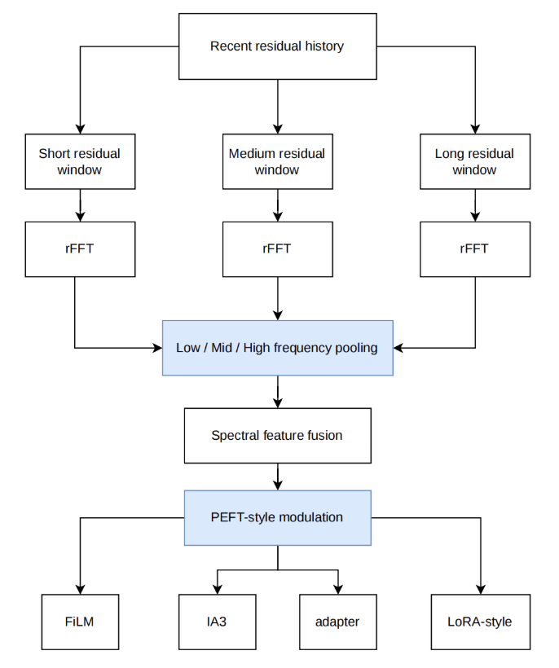

# Balanced Spectral-PEFT Branch

Branch: `c/2026-05-29-balanced-spectral-peft`

This branch contains the Balanced Spectral-PEFT experiment family for
time-series test-time adaptation. It keeps the base forecasting models frozen
and learns a lightweight output-space correction module during adaptation.

The method is separate from both the old Spectral/COSA path and the later Direct
Spectral Adapter (DSA) branch.

## What This Branch Implements

Balanced Spectral-PEFT builds a spectral condition vector from recent residuals
and uses that vector to mix several lightweight PEFT-style output backends.

At a high level:

1. The frozen forecasting backbone produces a base prediction
   `Y0 = f_theta(X)`.
2. The adapter records residual profiles `R = Y - Y0` from adaptation batches.
3. `MultiWindowSpectralEncoder` applies Hann, Hamming, and rectangular windows,
   runs `rFFT`, pools low/mid/high frequency bands, and fuses the windows into a
   condition vector.
4. `SpectralTuningBackend` produces FiLM, IA3, adapter, and LoRA-style
   candidate corrections.
5. `SpectralBalancedCOSAAdapter` combines backend outputs with a learned
   softmax gate and applies the residual-style output correction.

Only adapter-side parameters are updated during test-time adaptation. The base
forecasting model is not retrained by the balanced-only runs.

Important boundary: this branch does not implement direct inverse-FFT residual
shape correction. Its spectral signal is used as conditioning for output-space
PEFT backends.

## Architecture Diagram



The diagram summarizes the balanced adaptation path implemented in
`Spectral-master/tta/spectral_balanced.py`.

Recent residual history is the short buffer of residual profiles collected from
adaptation batches after the frozen forecasting backbone has produced its base
prediction. The encoder builds several spectral views of that residual history,
runs `rFFT`, and pools low-, mid-, and high-frequency bands into compact
features. In the current implementation, the multi-window views are Hann,
Hamming, and rectangular windows over the residual history; the short / medium /
long labels in the figure should be read as the conceptual multi-window
residual views rather than three separately configured history lengths.

`SpectralFusion` combines the window-level spectral features into one condition
vector. `SpectralTuningBackend` then uses that condition vector to produce and
mix PEFT-style output corrections: FiLM, IA3, adapter, and LoRA-style branches.
The learned backend mixture modulates the prediction in output space while the
base forecasting model remains frozen during test-time adaptation.

## Key Files

- `Spectral-master/tta/spectral_balanced.py`
  - Balanced Spectral-PEFT implementation.
  - Defines `MultiWindowSpectralEncoder`, `SpectralFusion`,
    `SpectralTuningBackend`, and `SpectralBalancedCOSAAdapter`.
- `Spectral-master/config.py`
  - Balanced config surface under `TTA.COSA.SPECTRAL.*` and
    `TTA.COSA.BALANCED.*`.
- `Spectral-master/main.py`
  - Routes to the balanced adapter when `TTA.COSA.BALANCED.ENABLED` is true or
    the result directory uses `COSA_BALANCED`.
- `Spectral-master/tests/test_spectral_balanced.py`
  - Focused tests for balanced encoder/backend behavior.
- `script/2026-05-29_balanced_spectral_peft/`
  - Dated runner, collector, and run instructions for this experiment family.
- `result/2026-05-29_balanced_spectral_peft/`
  - GPU schema6 balanced result archive.
- `result/2026-06-06_balanced_ablation_diagnosis/`
  - Diagnosis of why the balanced branch underperformed stronger direct
    spectral references.

## Current Result Archive

The current archived balanced result package is:

```text
result/2026-05-29_balanced_spectral_peft/
```

It contains the GPU schema6 run collected on 2026-06-08:

- `final_tables/balanced_branch_schema6_averaged.csv`
  - 171 model/dataset/horizon combinations averaged over 3 seeds.
- `final_tables/balanced_branch_schema6_full_results.csv`
  - 513 seed-level balanced results.
- `input/balanced_schema6_matrix.tsv`
  - The run matrix.
- `run_logs/balanced_schema6_matrix_20260608.log`
  - Driver log with 512 completed jobs and 1 skipped pre-existing job.

Headline mean over the 171 averaged combinations:

| Metric | Value |
| --- | ---: |
| Test MSE | 0.316349 |
| Test MAE | 0.360346 |

## How To Run

Use the dated balanced runner:

```bash
bash script/2026-05-29_balanced_spectral_peft/run_paper8_balanced_spectral.sh
```

For a small dry run:

```bash
DRY_RUN=True \
STAGES=balanced \
MODELS=DLinear \
DATASETS=ETTh1 \
PRED_LENS=96 \
SEEDS=0 \
bash script/2026-05-29_balanced_spectral_peft/run_paper8_balanced_spectral.sh
```

For the managed GPU run, reuse existing checkpoints and run the balanced stage
only:

```bash
SEEDS="0 1 2" \
STAGES=balanced \
MODELS="DLinear iTransformer FreTS" \
DATASETS="ETTh1 ETTm1 weather electricity" \
PRED_LENS="96 192 336 720" \
CONTINUE_ON_ERROR=True \
PYTHON=/home/normal/miniconda3/envs/cosa/bin/python \
bash ../script/2026-05-29_balanced_spectral_peft/run_paper8_balanced_spectral.sh
```

The remote GPU workspace used by the archived runs was:

```text
/home/normal/3830_FinalProject_COSA_latest_plan2_1/
```

## Artifact Policy

Datasets, checkpoints, and raw GPU result trees stay local-only. Do not commit:

- `data/`
- `checkpoints/`
- `results/`
- `Spectral-master/data/`
- `Spectral-master/checkpoints/`
- `Spectral-master/results/`
- any `checkpoint_best.pth`

Only curated result packages under `result/` should be committed.

## Relationship To Other Branches

- Balanced Spectral-PEFT: this branch.
- Direct Spectral Adapter: `c/2026-06-06-direct-spectral-adapter`.
- The DSA branch removes the balanced multi-backend PEFT mixture and uses a
  simpler direct residual-spectrum context adapter.
