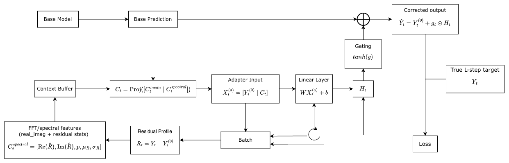

# COSA to Spectral Experiment Project

## Method Overview: Balanced Spectral-PEFT COSA

Balanced Spectral-PEFT COSA extends COSA by using a multi-window residual-spectrum encoder to condition lightweight output-space PEFT backends.



| Formula | Meaning |
|---|---|
| $Y_t^{(0)} = f_{\theta}(X_t)$ | Frozen base prediction from the pretrained backbone. |
| $R_t = Y_t - Y_t^{(0)}$ | Residual profile / base prediction error. |
| $S_k=\mathrm{rFFT}(w_k\odot R_t)$ | Multi-window residual-spectrum encoding. |
| $s=\mathrm{Fuse}(\mathrm{Pool}(S_1),\ldots,\mathrm{Pool}(S_K))$ | Unified spectral condition vector. |
| $H_m=\mathrm{Backend}_m(Y_t^{(0)},s)$ | FiLM, IA3, adapter, and LoRA-style lightweight PEFT outputs. |
| $\rho_m=\mathrm{softmax}(g(s))$ | Backend mixture weights. |
| $\hat{Y}_t=Y_t^{(0)}+\sum_m\rho_m(H_m-Y_t^{(0)})$ | Residual gated mixture correction. |
| $\mathcal{L}_{adapt} = \mathrm{MSE}(\hat{Y}_t, Y_t)$ | Adaptation loss for updating the adapter. |

For evaluation, both MSE and MAE are reported. The base model remains frozen; only adapter-related parameters are updated during test-time adaptation.

## 2026-05-29 Balanced Spectral-PEFT Experiment Design

The current Balanced Spectral-PEFT implementation lives under `Spectral-master/`.
The dated experiment entrypoint is kept under
`script/2026-05-29_balanced_spectral_peft/` to separate the new version from
older paper8 orchestration files.

The current main experiment is driven by:

```bash
bash script/2026-05-29_balanced_spectral_peft/run_paper8_balanced_spectral.sh
```

This script runs the paper-style grid plus two additional datasets:

- Datasets: `ETTh1`, `ETTh2`, `ETTm1`, `ETTm2`, `exchange_rate`, `weather`,
  `electricity`, and `traffic`
- Models: `DLinear`, `FreTS`, `iTransformer`, `MICN`, `OLS`, and `PatchTST`
- Prediction horizons: `96`, `192`, `336`, and `720`
- Window setup: look-back length `96`, label length `48`
- Split: train/validation/test = `0.7/0.1/0.2`
- Default seeds for this managed run: `0 1 2`

The script executes these stages by default:

```text
train -> baseline -> cosa -> balanced -> collect
```

The comparison includes:

- No-TTA baseline
- COSA with fixed batching
- COSA with PAAS batching
- Balanced Spectral-PEFT COSA using multi-window FFT conditioning and gated PEFT backends

For the Balanced setting, the default spectral encoder uses Hann, Hamming, and
rectangular windows, `real_imag` spectral features, low/mid/high band pooling,
softmax-gate window fusion, condition dimension `8`, and FiLM/IA3/adapter/LoRA
backends with residual mixture fusion.

## Training Reliability Logic

The 2026-05-27 update changes the training script to make long grid runs easier
to manage:

- Default seeds are reduced from ten seeds to `0 1 2` for a tractable managed
  run.
- `PYTORCH_CUDA_ALLOC_CONF=expandable_segments:True` is exported by default to
  reduce CUDA memory fragmentation.
- `CONTINUE_ON_ERROR=True` lets the grid continue after a failed train,
  baseline, COSA, Balanced Spectral-PEFT, or collection job.
- Failures are recorded in `Spectral-master/results/summary/paper8_failures.tsv`
  with run id, timestamp, stage, model, dataset, horizon, seed, variant, and
  exit code.
- Result collection allows partial outputs by default. Set
  `COLLECT_REQUIRE_COMPLETE=True` when a strict complete-grid collection is
  required.

Useful overrides:

```bash
# Run the original ten-seed grid.
SEEDS="0 1 2 3 4 5 6 7 8 9" bash script/2026-05-29_balanced_spectral_peft/run_paper8_balanced_spectral.sh

# Stop immediately on the first failed job.
CONTINUE_ON_ERROR=False bash script/2026-05-29_balanced_spectral_peft/run_paper8_balanced_spectral.sh

# Collect only after all expected outputs are present.
COLLECT_REQUIRE_COMPLETE=True bash script/2026-05-29_balanced_spectral_peft/run_paper8_balanced_spectral.sh
```

The original implementation README remains available at
`Spectral-master/README.md`.
