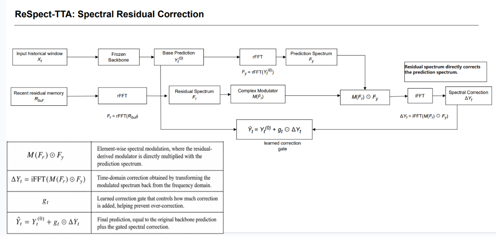
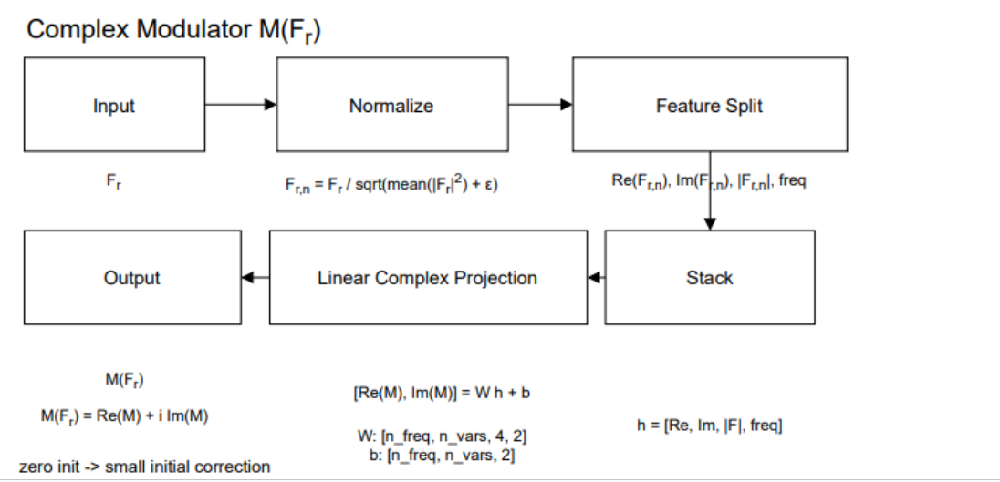

# ReSpect-TTA Experiment Project

## Method Overview

This repository focuses on **ReSpect-TTA**, a residual-conditioned complex
frequency modulation method for online test-time adaptation in time-series
forecasting.

The base forecasting backbone remains frozen. ReSpect-TTA keeps a recent
residual memory, converts the base prediction and residual memory into the
frequency domain, learns a complex modulator from the residual spectrum, and
adds a gated spectral correction back to the original prediction.

Current main candidate:

```text
adapter_context_plus_complex_modulation_high_gate_lr
```

## Diagrams

### ReSpect-TTA Pipeline



### Complex Modulator



Editable diagram sources:

- `respect_tta.drawio`
- `complex_modulator_flowchart.drawio`

## Core Formula

| Formula | Meaning |
|---|---|
| $Y_t^{(0)} = f_{\theta}(X_t)$ | Frozen backbone prediction. |
| $R_t = Y_t - Y_t^{(0)}$ | Base prediction residual after ground truth arrives. |
| $F_y = \mathrm{rFFT}(Y_t^{(0)})$ | Prediction spectrum. |
| $F_r = \mathrm{rFFT}(R_{buf})$ | Recent residual spectrum. |
| $M(F_r)$ | Residual-conditioned complex modulation operator. |
| $\Delta Y_t = \mathrm{iFFT}(M(F_r) \odot F_y)$ | Time-domain spectral correction. |
| $\hat{Y}_t = Y_t^{(0)} + g_t \odot \Delta Y_t$ | Final gated forecast. |

## Key Idea

ReSpect-TTA treats the recent residual spectrum as an active correction operator.
The residual spectrum is used to generate a complex modulator that directly
changes the prediction spectrum before the correction is reconstructed through
inverse FFT.

Short version:

```text
Y_t^(0) -> F_y
R_buf -> F_r -> M(F_r)
Delta Y_t = iFFT(M(F_r) odot F_y)
Y_hat_t = Y_t^(0) + g_t odot Delta Y_t
```

## Main Result

The main collected run evaluates:

```text
adapter_context_plus_complex_modulation_high_gate_lr
```

Across 171 collected model-dataset-horizon conditions, each averaged over three
seeds, ReSpect-TTA obtains:

```text
161/171 wins vs no-TTA baseline
+14.37% mean MSE improvement vs no-TTA baseline
162/171 wins vs the context-only spectral reference
+3.07% mean MSE improvement vs the context-only spectral reference
```

## Experiment Story

The final method was reached through the following experimental path:

| Step | Test | Result |
|---|---|---|
| Residual-only | Directly add recent residual information | Failed; almost no improvement |
| Complex modulation | Use `M(F_r) odot F_y` to correct the prediction spectrum | Useful signal, but unstable alone |
| Gate diagnostics | Test correction strength policies | Gate behavior is critical |
| Long-horizon direct-only | Test direct path on long horizons | Better than no-TTA, but not stable enough |
| Low-pass sweep | Restrict correction to low frequencies | Did not solve the issue |
| Context-plus-complex | Combine stable context adaptation with direct complex correction | First strong design direction |
| Full 3-seed run | Validate the final candidate broadly | Main ReSpect-TTA result |
| Pred720 diagnostics | Analyze long-horizon weakness | Remaining issue is gate stability |

## Result Files

The most important result files are:

```text
result/respect_tta/
  respect_tta_main_results.csv
  respect_tta_main_averaged.csv
  respect_tta_main_improvement.csv
```

Meaning:

```text
results.csv      = collected raw run results
averaged.csv     = seed-averaged condition results
improvement.csv  = comparison and relative improvement table
```

## Notes

The implementation code and historical experiment names are kept for
reproducibility. Some internal paths and variant names still use legacy
identifiers, while the presentation/report name is **ReSpect-TTA**.
